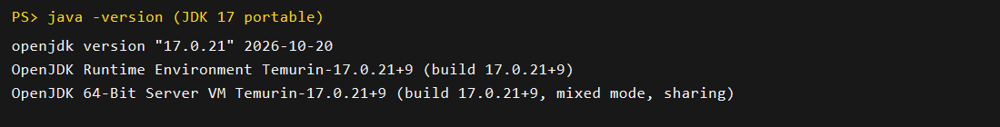
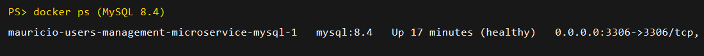
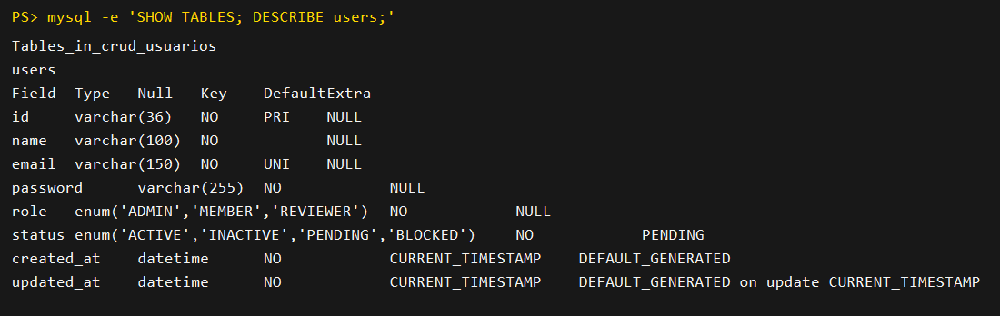
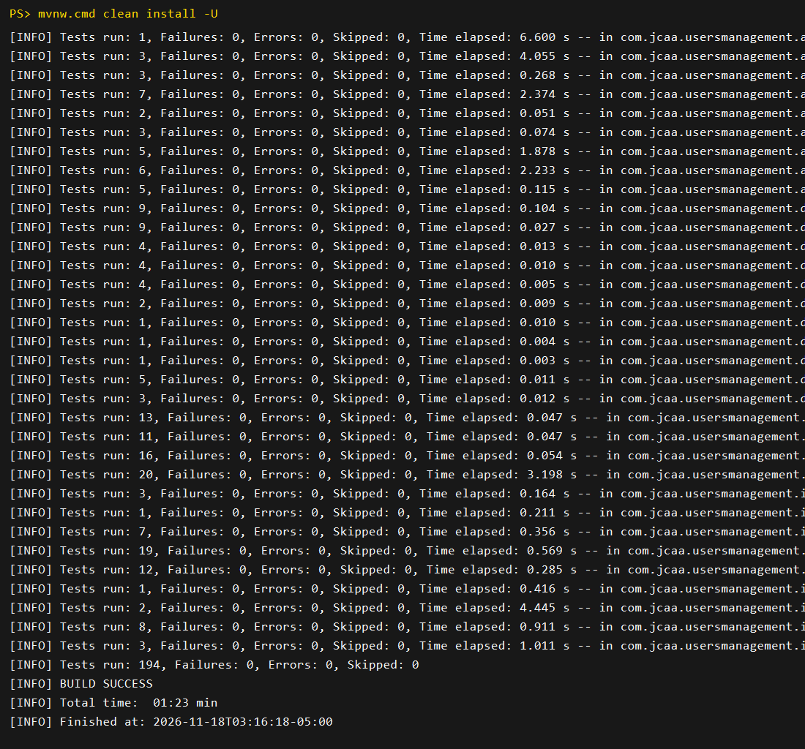
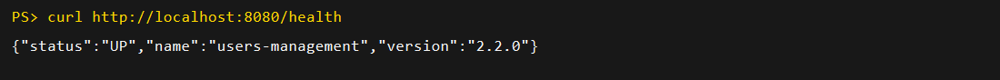

# Paso 02 — Entorno local: JDK 17, MySQL en Docker, build y arranque (Guía 1)

## 1. JDK 17 (sin instalador, sin admin)
El equipo tenía Java 26, pero el proyecto usa Spring Boot 3.3.5 + Lombok con `java.version=17`. Se descargó Temurin 17 en formato ZIP a `C:\Users\andre\tools\jdk17` y se usa solo en la sesión de terminal (`JAVA_HOME`), sin modificar el Java global.



> Nota: el instalador MSI de `winget` quedó esperando permisos de administrador (UAC), por eso se pasó a la versión portable.

## 2. MySQL 8.4 con Docker
En vez de instalar MySQL Server, se levanta el servicio `mysql` del `compose.yaml` del proyecto (base `crud_usuarios`, usuario `users_app`). El `schema.sql` se ejecuta solo al crear el contenedor.
```
docker compose up -d mysql
```


Verificación de que el esquema se creó (tabla `users`):



## 3. Compilación con Maven Wrapper
```
$env:JAVA_HOME="C:\Users\andre\tools\jdk17"
.\mvnw.cmd clean install -U
```
Resultado: **BUILD SUCCESS**, 194 tests, 0 fallos.



## 4. Arranque y prueba
```
$env:DB_HOST="localhost"; $env:DB_USERNAME="users_app"; $env:DB_PASSWORD="local_users_password"
java -jar target\users-management-2.2.0.jar
curl http://localhost:8080/health
```


## Pendiente de la Guía 1
- Conexión desde un IDE / cliente SQL (IntelliJ no está instalado; opcional).
