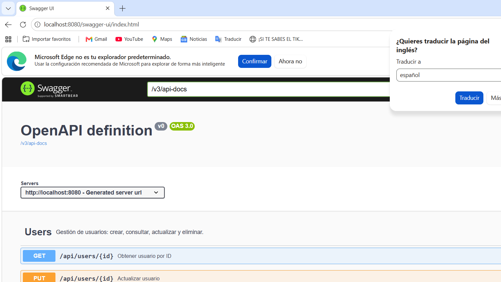
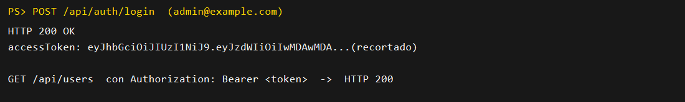

# Paso 03 — Verificación de la API en local (antes de pasar a Aiven) (Guía 2, pasos 15–16)

Antes de apuntar la app a la base remota, se validó con el MySQL local que el flujo final de la Guía 2 funciona.

## Swagger UI
`http://localhost:8080/swagger-ui/index.html`

## Login con el administrador inicial y consumo de endpoint protegido
El `schema.sql` inserta `admin@example.com` / `Admin1234!`. `POST /api/auth/login` devuelve 200 con `accessToken` (JWT) y con ese token `GET /api/users` devuelve 200.

## Siguiente (Guía 2 con Aiven)
Crear cuenta y servicio MySQL en Aiven, ejecutar `schema.sql` allí y apuntar la app con variables de entorno / archivo `.env` (ignorado por git, nunca se sube la contraseña).
