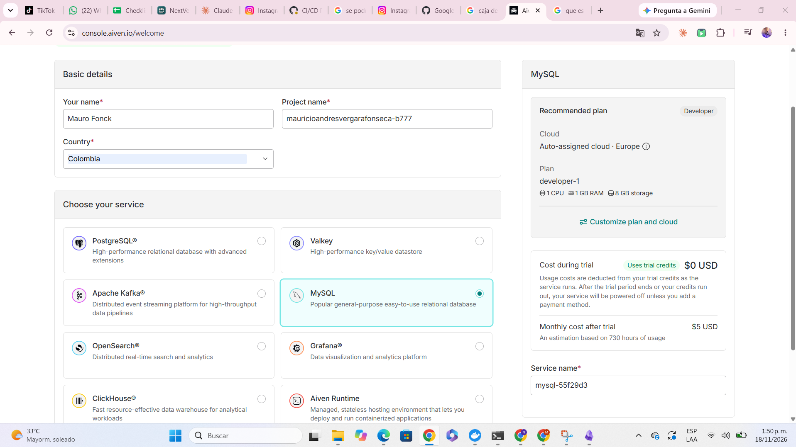
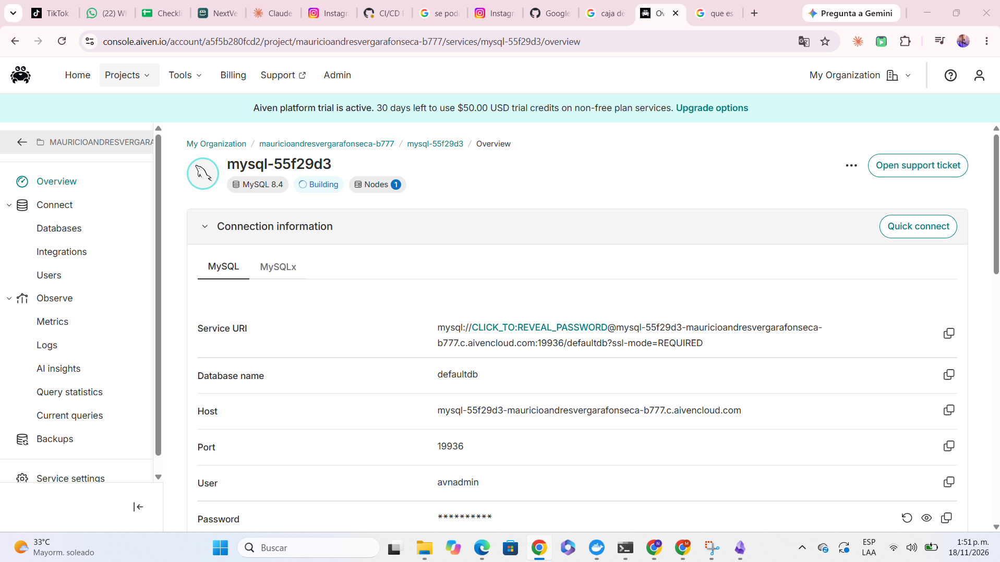
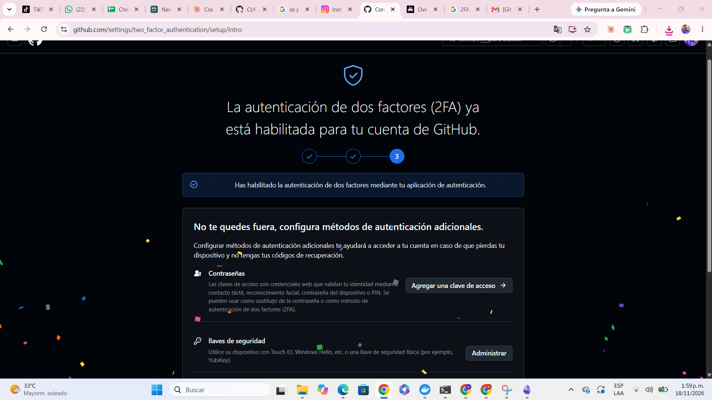
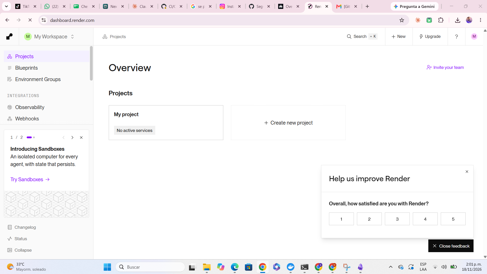
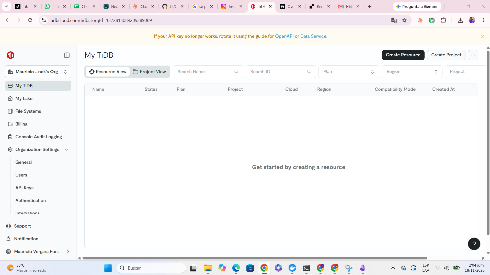
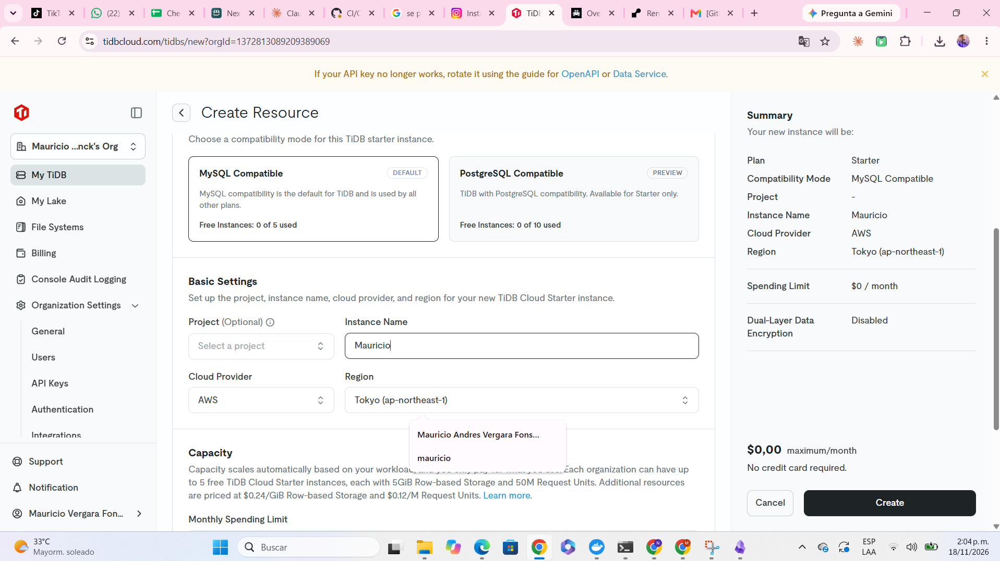
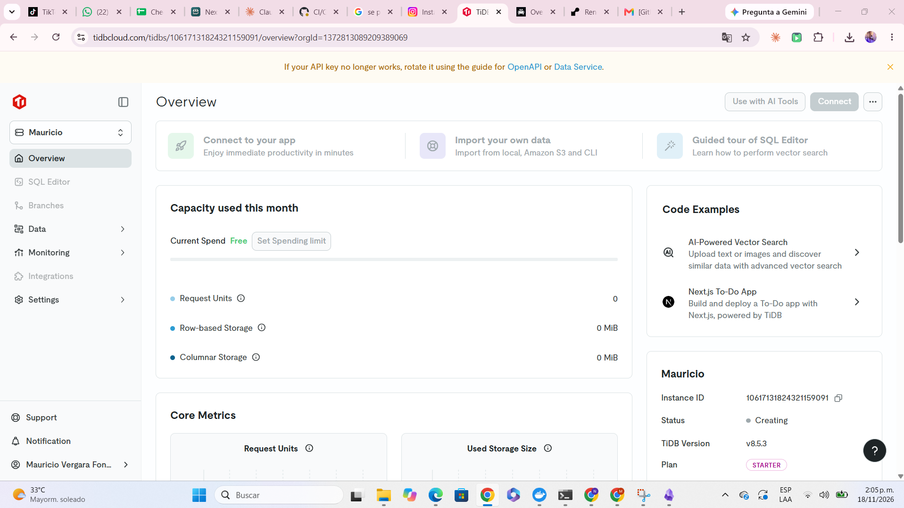
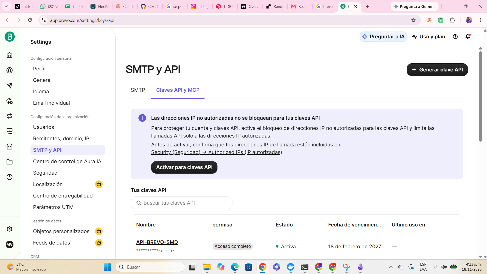
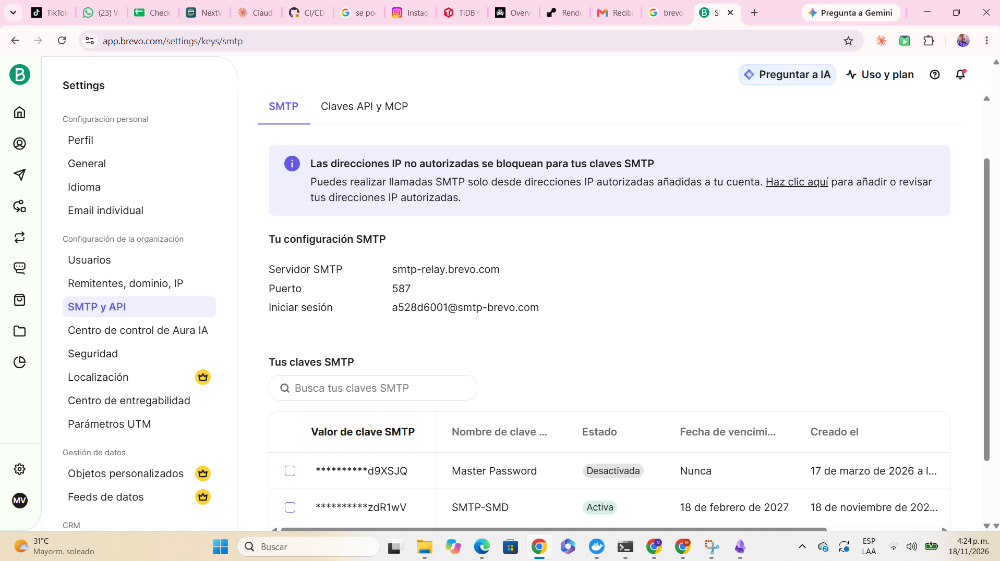

# Paso 04 — Creación de cuentas en servicios cloud (Guías 2, 3, 4 y 5)

Estas cuentas las creó Mauricio manualmente (requieren datos personales, verificación y 2FA). Los secretos **no** se guardan en el repositorio: viven en el archivo local `.env`, que está en `.gitignore`.

## Aiven — MySQL en la nube (Guía 2)
Servicio MySQL 8.4, plan `developer-1`, costo $0 durante el trial (30 días, $50 en créditos).

Datos de conexión (la contraseña queda en `.env`):

| Campo | Valor |
|-------|-------|
| Host | `mysql-55f29d3-mauricioandresvergarafonseca-b777.c.aivencloud.com` |
| Puerto | `19936` |
| Base | `defaultdb` |
| Usuario | `avnadmin` |
| SSL | `REQUIRED` |

## GitHub 2FA y Render — despliegue (Guía 3)
2FA activado en GitHub (requisito para Render) y cuenta de Render creada con GitHub.

## TiDB Cloud — base definitiva (Guía 4)
Plan Starter (gratis, sin tarjeta), compatible con MySQL, límite de gasto $0.

> La región elegida fue Tokyo (ap-northeast-1); la guía sugiere us-east-1. Funciona igual, con algo más de latencia hacia Render.

## Brevo — correos (Guía 5)
Servidor SMTP `smtp-relay.brevo.com`, puerto `587`. Se generaron una clave SMTP (`SMTP-SMD`) y una clave API (`API-BREVO-SMD`), ambas activas hasta el 18/02/2027.

> Brevo bloquea las claves SMTP desde IPs no autorizadas. Hay que agregar la IP de este equipo (y luego la de Render) en Seguridad → IP autorizadas.

## Pendiente
- Contraseña de Aiven y de TiDB en `.env`.
- Remitente verificado en Brevo para `SMTP_FROM_ADDRESS`.
