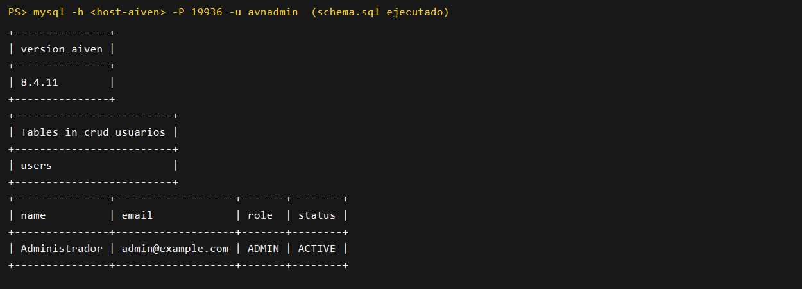
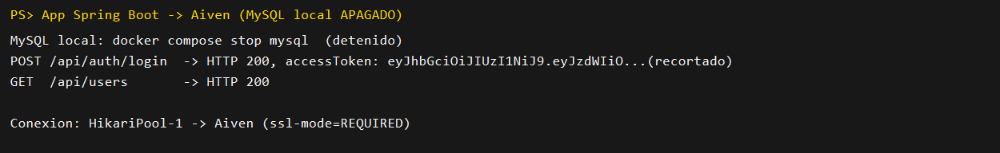

# Paso 05 — Base de datos remota en Aiven y app conectada (Guía 2)

## 1. Esquema cargado en Aiven
Se ejecutó `src/main/resources/schema.sql` contra el MySQL de Aiven (cliente `mysql` de la imagen Docker `mysql:8.4`, conexión SSL obligatoria). Se creó la base `crud_usuarios`, la tabla `users` y el administrador inicial.

## 2. Configuración sin secretos en el código
La app lee su configuración de variables de entorno y, si existe, del archivo `.env` (`spring.config.import=optional:file:.env[.properties]`). El `.env` está en `.gitignore`, así que las credenciales no se suben a GitHub. Variables usadas: `DB_HOST`, `DB_PORT`, `DB_NAME`, `DB_USERNAME`, `DB_PASSWORD`, `DB_SSL_MODE=REQUIRED`.

## 3. Prueba de la aplicación contra Aiven
Se arrancó el JAR y se detuvo el MySQL local (`docker compose stop mysql`) para demostrar que la app usa la base remota. Login con el admin y consumo de un endpoint protegido: ambos HTTP 200.

## Pendiente
- Cambiar la contraseña y el correo del admin por defecto (buena práctica de la Guía 3).
- Guía 3: desplegar en Render (necesita la IP de Render para Brevo).
