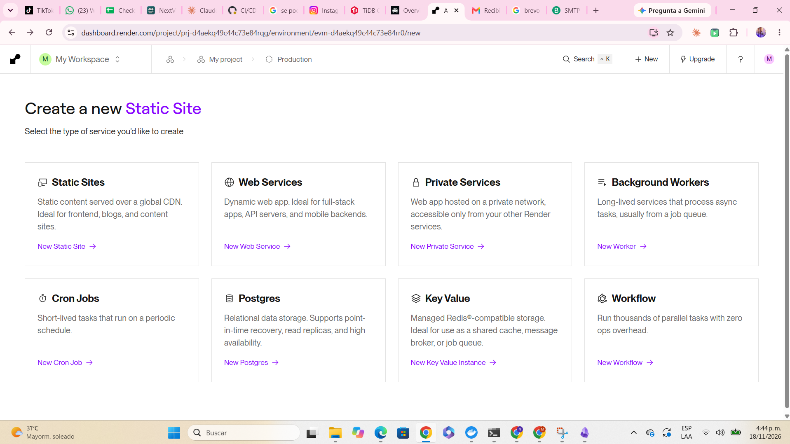
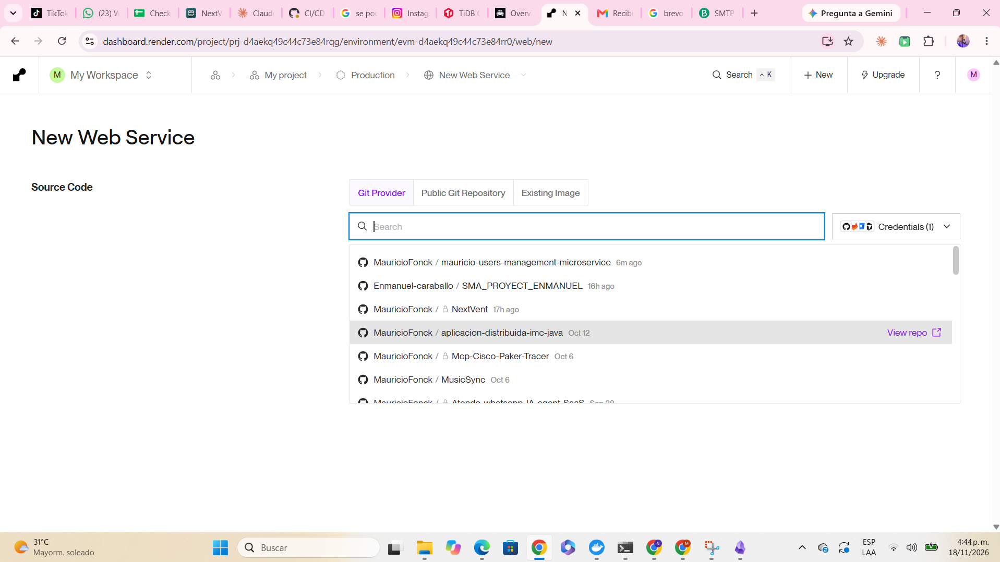
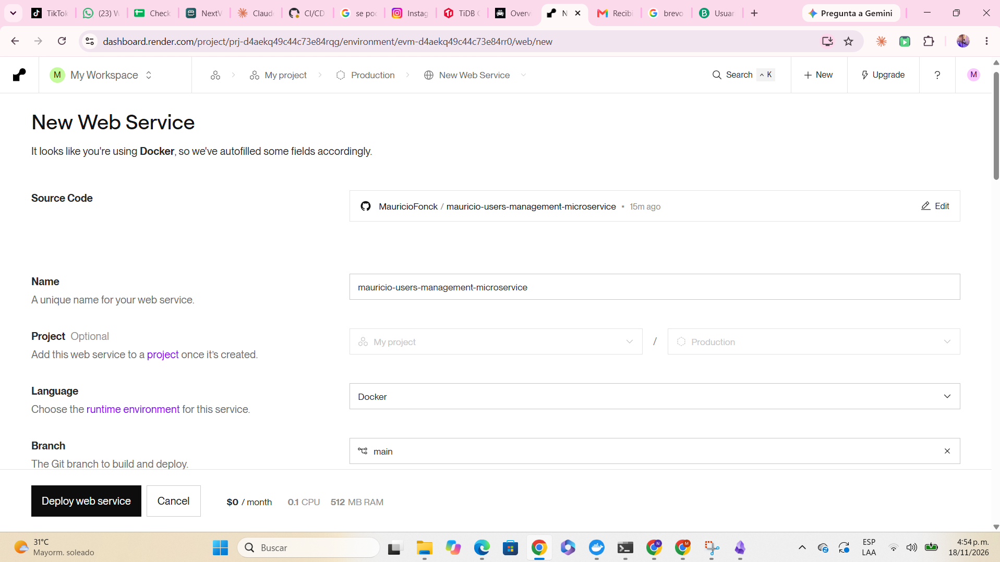
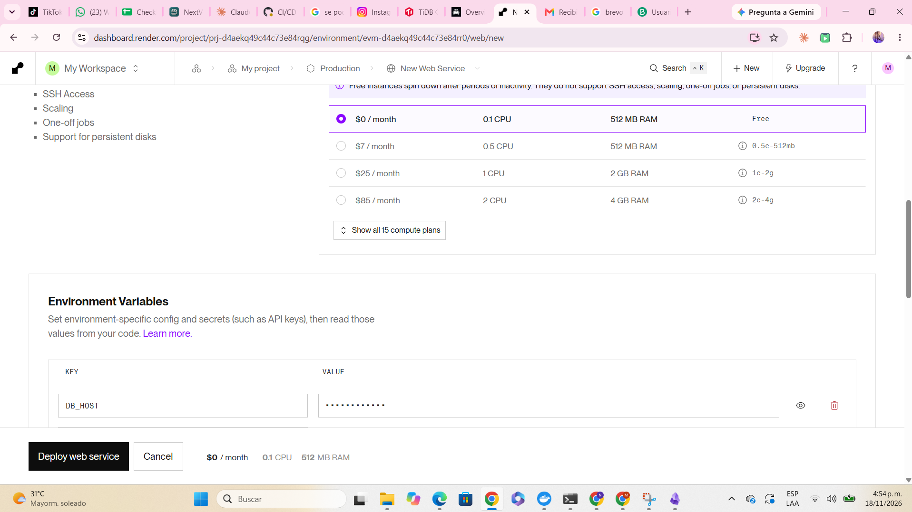
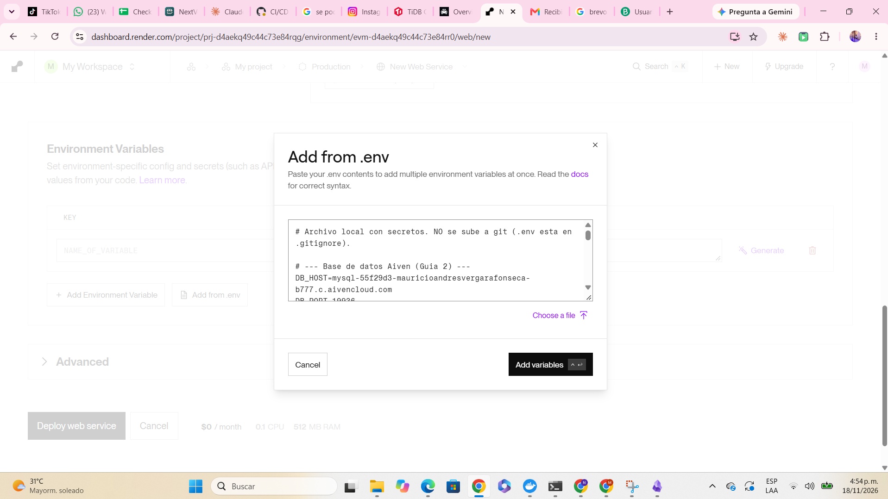
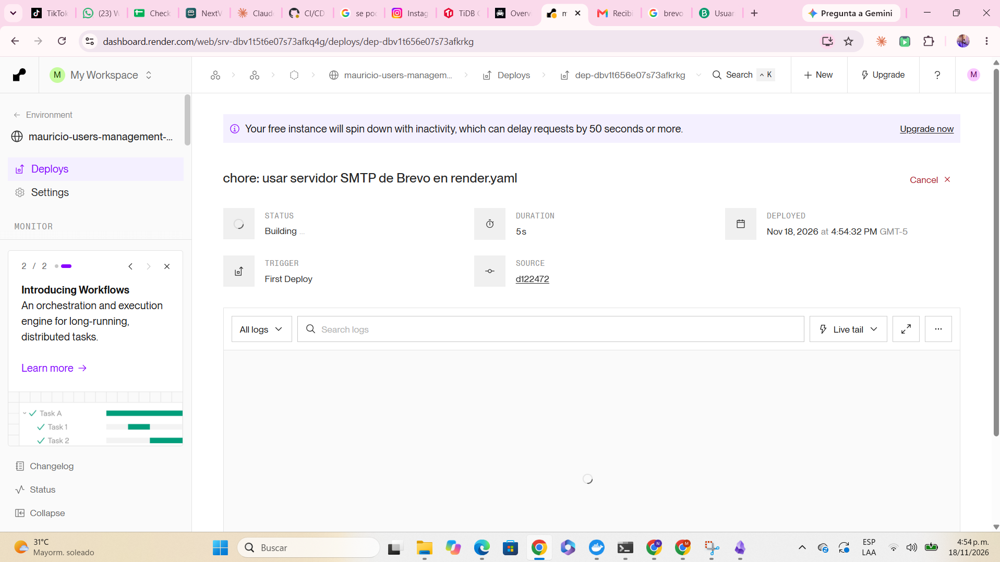

# Paso 06 — Despliegue en Render (Guía 3)

Se creó un **Web Service** manual en Render (no Blueprint) conectado al fork en GitHub.

## 1. Tipo de servicio
En el proyecto `My project / Production` se elige **Web Services → New Web Service**.

## 2. Repositorio
Pestaña *Git Provider*; se selecciona `MauricioFonck/mauricio-users-management-microservice`.

## 3. Configuración básica
Render detecta el `Dockerfile` y autocompleta el runtime **Docker**. Rama `main`, Root Directory vacío (el proyecto está en la raíz).

## 4. Plan
Instancia **Free** ($0/mes, 0.1 CPU, 512 MB RAM). Se duerme tras inactividad y la primera petición puede tardar ~50 s.

## 5. Variables de entorno
Se cargaron de una vez con **Add from .env** (los valores quedan ocultos en Render; no se guardan en el repo).

Variables: `DB_HOST`, `DB_PORT`, `DB_NAME`, `DB_USERNAME`, `DB_PASSWORD`, `DB_SSL_MODE`, `SMTP_*`, `JWT_SECRET`.

> Al crear el servicio manualmente, Render **no** lee el `render.yaml`, así que todas las variables (incluido `JWT_SECRET`) deben definirse a mano.

## 6. Primer deploy
Con **Deploy web service** arranca el build Docker a partir del último commit (`d122472`). Cada `git push` a `main` dispara un nuevo deploy automático (CI/CD).

## Pendiente
- Esperar estado **Live** y probar `/health`, login y Swagger en la URL pública.
- Obtener la IP de salida de Render para autorizarla en Brevo (Guía 5).
