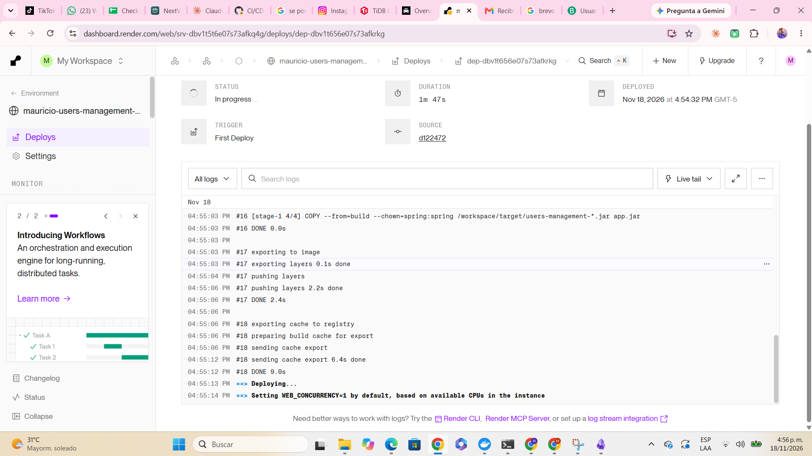
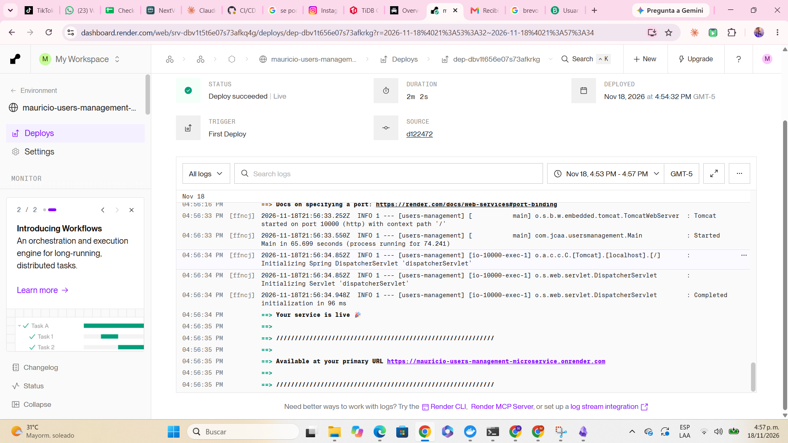
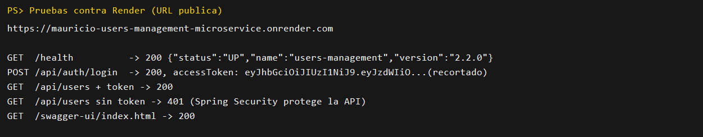

# Paso 07 — Servicio en vivo en Render y pruebas (Guía 3)

URL pública: $u

## Logs del despliegue
- Build Docker: `mvn clean package` terminó en **BUILD SUCCESS**.
- Spring Boot arrancó y se conectó a Aiven: `HikariPool-1 - Start completed`.
- Render: **Your service is live**.

Capturas del panel de Render:

## Pruebas desde la terminal

- `/health` → 200 `UP`.
- Login del admin inicial → 200 con JWT; `/api/users` con token → 200 y **sin token → 401**.
- Swagger UI accesible en `/swagger-ui/index.html`.

## Hallazgo de seguridad
Al servicio manual no se le había definido `JWT_SECRET` (solo `render.yaml` lo generaba) y la app usaba la **clave de desarrollo por defecto** del código. Se verificó firmando un token con esa clave. Corrección: definir un `JWT_SECRET` aleatorio en *Environment* de Render y redesplegar.

## Corrección verificada
Se definió un `JWT_SECRET` aleatorio (32 bytes en Base64) en *Environment* de Render y se redesplegó. Verificación posterior: un token nuevo **ya no valida con la clave por defecto** y sí con el secreto nuevo. Los tokens emitidos antes del cambio dejan de ser válidos.

## Pendiente
- Cambiar el email y la contraseña del admin por defecto (`admin@example.com` / `Admin1234!`).
- Probar Swagger en navegador y obtener la IP de salida de Render (Guía 5).
