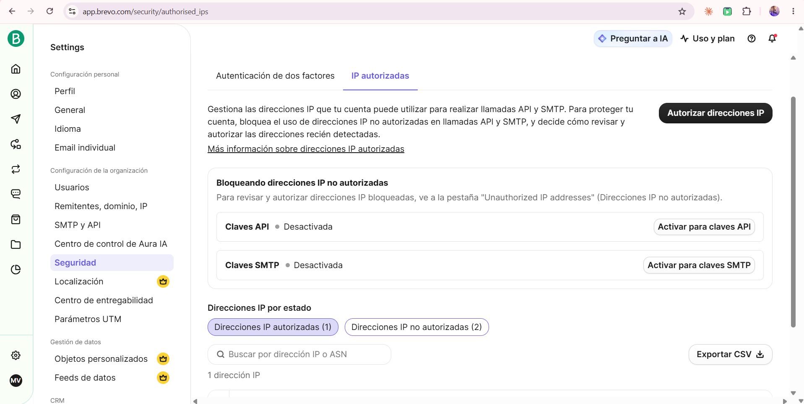

# Paso 08 — Notificaciones por correo con la API de Brevo (Guía 5)

## 1. Por qué la API y no SMTP
Render bloquea los puertos SMTP (25, 465, 587) en sus instancias gratuitas. La rama `feature/brevo-rest-email-resilience` del repositorio original reemplaza el adaptador SMTP (`JavaMailEmailSenderAdapter`) por uno que llama a la **API REST de Brevo** por HTTPS (`BrevoEmailSenderAdapter`), con reintentos y circuit breaker (Resilience4j).

## 2. Integración de la rama (flujo de la guía)
```
git fetch upstream
git switch -c feature/brevo-rest-email-resilience --no-track upstream/feature/brevo-rest-email-resilience
git merge main            # 3 conflictos resueltos: .gitignore, render.yaml, application.properties
```
Resolución de conflictos:
- `.gitignore`: se conservan ambas reglas de secretos.
- `render.yaml`: se usan las variables `BREVO_*` y se eliminan las `SMTP_*`.
- `application.properties`: `spring.config.import` lee tanto `.env` como `.environments/application-secrets.properties`.

Verificación local: `mvnw clean install` → **199 tests, 0 fallos**. Luego `git push` de la rama y **Pull Request #1** fusionado en `main` de este fork.

## 3. Variables de entorno
| Variable | Uso |
|----------|-----|
| `BREVO_API_KEY` | Clave API de Brevo (secreto) |
| `BREVO_FROM_ADDRESS` | Remitente **verificado** en Brevo |
| `BREVO_FROM_NAME` | Nombre visible del remitente |

Las `SMTP_*` quedaron obsoletas y se eliminaron. Los valores viven en el `.env` local (ignorado por git) y en *Environment* de Render.

## 4. Problemas encontrados
1. **HTTP 401 de Brevo** ("unrecognised IP address"): Brevo bloquea llamadas desde IPs no autorizadas. Se desactivó el bloqueo para claves API y SMTP en *Seguridad → IP autorizadas* (taller; en producción se autorizarían las IPs concretas).

   

2. **Remitente**: la cuenta solo tenía verificado `notificaciones@cositracker.online`; un remitente no verificado (p. ej. un Gmail) es rechazado por Brevo, así que `BREVO_FROM_ADDRESS` usa ese.

## 5. Prueba extremo a extremo
- En local: se creó un usuario de prueba y el log mostró `correo aceptado por Brevo`.
- En Render (URL pública): `POST /api/users` → 201 y el registro transaccional de Brevo muestra el correo **"Tu cuenta ha sido creada — Gestion de Usuarios"**. Los usuarios de prueba se borraron después.

## Nota de seguridad
La plantilla `user-created.html` incluye una contraseña temporal en el correo (código del instructor). Es aceptable en un taller; en producción se debería enviar un enlace de un solo uso.
