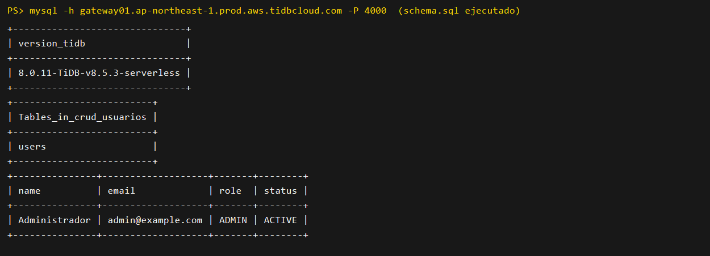
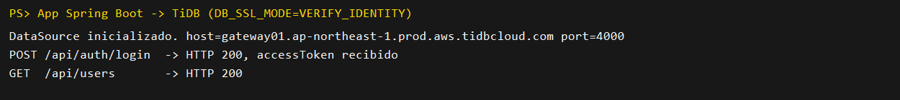

# Paso 09 — Migración de Aiven a TiDB Cloud (Guía 4)

TiDB Cloud Starter ofrece un plan gratuito que no vence en el tiempo y es compatible con MySQL.

## 1. Recurso en TiDB
Instancia **Starter** (AWS, región Tokyo `ap-northeast-1`), límite de gasto $0. Versión del servidor: `8.0.11-TiDB-v8.5.3-serverless`. Puerto de conexión `4000`, conexión TLS obligatoria. Ver capturas de creación en el [paso 04](paso-04-cuentas-cloud.md).

## 2. Creación de la base y el esquema
La guía lo hace desde el *SQL Editor* de TiDB y desde el IDE; aquí se ejecutó el mismo `schema.sql` con el cliente `mysql` (imagen Docker) por TLS. Crea la base `crud_usuarios`, la tabla `users` y el admin inicial.

## 3. Prueba local contra TiDB
Variables (en el `.env` local, ignorado por git): `DB_HOST`, `DB_PORT=4000`, `DB_NAME=crud_usuarios`, `DB_USERNAME`, `DB_PASSWORD` y **`DB_SSL_MODE=VERIFY_IDENTITY`** (verifica el certificado y el nombre del servidor). El usuario de TiDB lleva un prefijo (`<id>.root`).

## 4. Variables en Render
En *Environment* del servicio se actualizan `DB_HOST`, `DB_PORT`, `DB_NAME`, `DB_USERNAME`, `DB_PASSWORD` y `DB_SSL_MODE=VERIFY_IDENTITY`, y se pulsa **Save, rebuild, and deploy**.

## 5. Verificación en producción
Con las variables ya actualizadas en Render, se creó un usuario de prueba por la URL pública (`POST /api/users` → 201) y se consultó **directamente TiDB**: la fila existía allí, lo que confirma que la API desplegada usa TiDB y ya no Aiven. El usuario de prueba se borró después.

## Nota
La base de Aiven queda como respaldo (sus datos están en el `.env` como `AIVEN_*`); el trial de Aiven vence a los 30 días.
